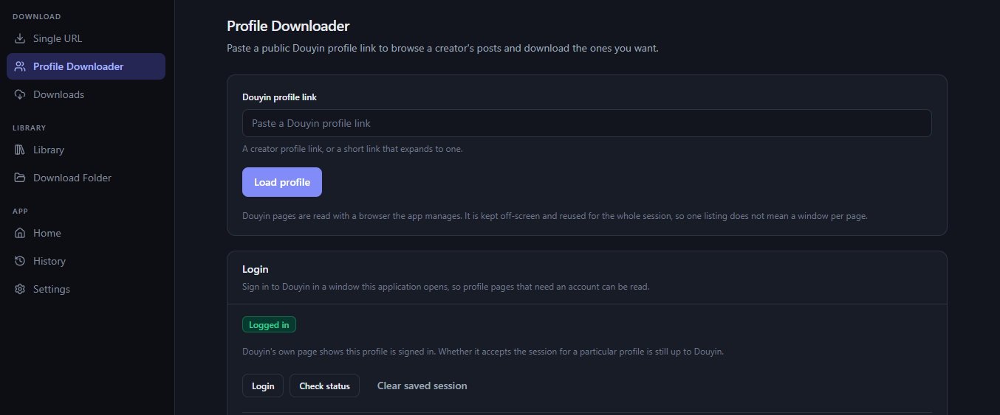
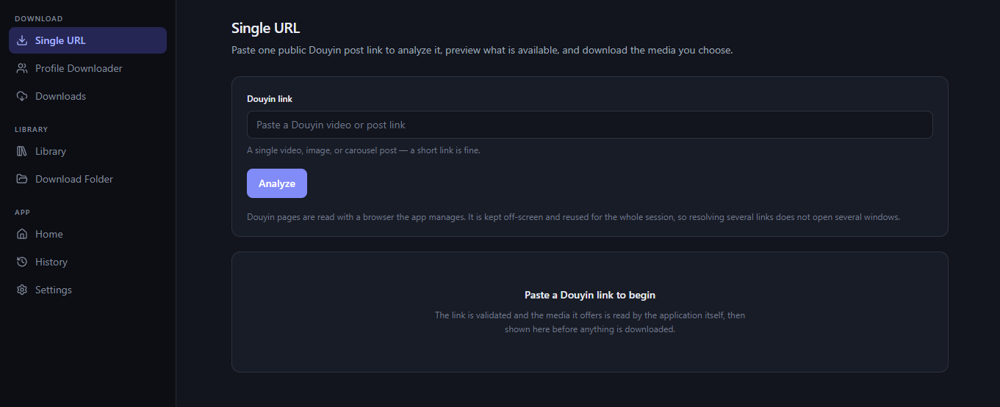
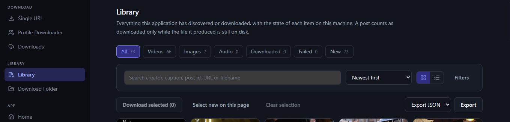
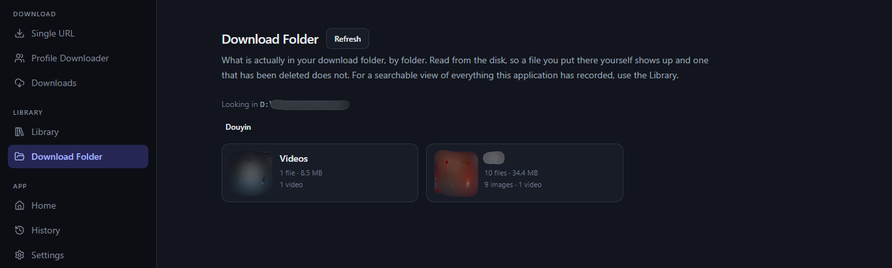

<div align="center">

# Douyin Downloader

**A Windows desktop app to save publicly accessible Douyin media and organize it locally.**

[](https://www.microsoft.com/windows)
[](https://tauri.app/)
[](https://www.rust-lang.org/)
[](https://react.dev/)
[](LICENSE)

[Features](#features) · [Screenshots](#screenshots) · [Installation](#installation) · [Build from source](#build-from-source) · [Troubleshooting](#troubleshooting) · [Changelog](CHANGELOG.md) · [Design notes](idea/README.md) · [License](LICENSE)

</div>

---

## Overview

Douyin Downloader is a native-feeling Windows desktop application built with **Tauri 2, Rust, React, and TypeScript**. Paste a post URL or a profile URL, inspect the media the app can access, choose what to save, and manage your downloads from one place.

The app keeps its library, download history, settings, and downloaded files on your computer. Resolving Douyin pages and downloading media still requires network requests to Douyin and its media hosts. Optional browser-assisted profile loading uses a browser profile managed separately by the app.

> **Release status:** [v1.0.1](https://github.com/VietAIMEM/douyin-media-downloader/releases/tag/v1.0.1) is the first public release — a per-user NSIS installer for Windows x64. See the [Releases page](https://github.com/VietAIMEM/douyin-media-downloader/releases) for downloads and [CHANGELOG.md](CHANGELOG.md) for what each version contains. The installer is not code-signed, so SmartScreen may warn on first run.

## Features

| Feature | What it does |
| --- | --- |
| **Single URL Downloader** | Paste a Douyin post link, inspect available media, preview supported items or variants, and select what to download. |
| **Profile Downloader** | Browse publicly accessible posts from a profile, filter by media type, and select multiple posts for the download queue. |
| **Download queue** | Track task status and progress, with speed and estimated time remaining when available. Task actions are shown only when supported. |
| **Library** | Search, filter, and browse discovered media with thumbnails and file-presence information. |
| **Download Folder** | Browse files directly from the selected download directory, including files that were placed there outside the app. |
| **History** | Review completed, failed, and cancelled tasks and the files associated with them. |
| **Flexible organization** | Configure the download location, filename rules, folder organization, and download concurrency. |
| **Media preview** | Preview supported media before opening or managing the corresponding file. |

The media available for a post depends on what Douyin makes accessible. Supported content can include videos, images, image carousels, and audio resources. Separate video and audio streams may need FFmpeg to be combined into a playable file.

## Screenshots

**Profile Downloader** — load a creator's publicly accessible posts and select across pages.



**Single URL** — analyse one post and choose which of its media to download.



**Library** — search, filter and browse everything the application has discovered.



**Download Folder** — what is actually on disk, read by folder.



The screenshots show the dark theme and English interface. In the Download Folder view the local path and the thumbnails are blacked out.

## Installation

Download the installer from the project's [GitHub Releases page](https://github.com/VietAIMEM/douyin-media-downloader/releases), rather than from an unofficial mirror.

1. Download `Douyin Downloader_1.0.1_x64-setup.exe` from [v1.0.1](https://github.com/VietAIMEM/douyin-media-downloader/releases/tag/v1.0.1).
2. Run it. The installer is **per-user** — it installs for the current account only and normally does not require administrator elevation.

The installer is **not code-signed**, so Windows will not show a publisher name and SmartScreen may warn on first run. Verify the download before running it:

| | |
| --- | --- |
| Size | 3 377 301 bytes |
| SHA-256 | `114a762f4d30c27da2f48592ee0aebb4552590d96d0e13f2a532d864d89b0bb2` |

```powershell
Get-FileHash ".\Douyin Downloader_1.0.1_x64-setup.exe" -Algorithm SHA256
```

When building from source on Windows, the project can produce these installer formats:

| Package | Install scope | Notes |
| --- | --- | --- |
| **NSIS** (`*-setup.exe`) | Current user | Recommended for a personal installation; normally does not require administrator elevation. |
| **MSI** (`*.msi`) | Per machine | May require administrator privileges. |

## Build from source

### Requirements

Use a **Windows x64** development environment with the following tools:

| Tool | Requirement | Purpose |
| --- | --- | --- |
| Windows | Windows 11 recommended | Target desktop platform. |
| Node.js | 24.x | Frontend tooling and tests. |
| Rust | 1.77 or newer, MSVC toolchain | Rust application core. |
| Visual Studio Build Tools | Visual Studio 2022 C++ build tools | Native compilation and linking. |
| Windows SDK | Windows 10/11 SDK | Windows and WebView2 build dependencies. |
| WebView2 Runtime | Installed on the system | Hosts the Tauri UI. It is included with most Windows 11 installations. |
| FFmpeg / FFprobe | Optional, recent build recommended | Needed for workflows that must combine separate video and audio streams; also useful for media inspection and thumbnails. |
| Chrome or Edge | Recommended | Some Douyin pages may require browser-assisted rendering to expose accessible post information. |

### Clone and install dependencies

```powershell
git clone https://github.com/VietAIMEM/douyin-media-downloader.git
cd douyin-media-downloader\code
npm ci
```

### Run the desktop app in development

```powershell
npm run tauri:dev
```

### Build the Windows installers

```powershell
npm run tauri:build
```

The build artifacts are generated under `src-tauri\target\release\bundle\`. The exact subdirectories and packages depend on the Windows build environment and Tauri configuration.

### Run checks

From the `code` directory:

```powershell
npm run typecheck
npm test
npm run build
cargo test --manifest-path src-tauri\Cargo.toml --all-targets
cargo clippy --manifest-path src-tauri\Cargo.toml --all-targets -- -D warnings
```

A small number of live integration tests are intentionally ignored by the default test run because they depend on external network access and/or a locally installed browser. Do not run those tests unless you intend to test against live services.

## Troubleshooting

<details>
<summary><strong>A video downloads without audio, or the app reports that FFmpeg is required</strong></summary>

Some posts expose video and audio as separate streams. Install a recent FFmpeg build and make sure `ffmpeg` and `ffprobe` are available on `PATH`. If the executables are installed in a custom location, consult the app's settings or project configuration for the supported path override.

</details>

<details>
<summary><strong>A profile or post cannot be loaded</strong></summary>

Only content the app can legitimately access is supported. Some pages may be unavailable, region-restricted, require an existing user session, or change their response format. Check the URL and network connection first. Browser-assisted resolution and profile-session options are configurable; they do not bypass access controls or guarantee that every post can be retrieved.

</details>

<details>
<summary><strong>A downloaded file is shown as missing or unavailable</strong></summary>

The Library distinguishes a file that is confirmed missing from a file whose presence cannot be checked—for example, when an external drive is disconnected or a path is temporarily inaccessible. Reconnect the relevant drive or restore access to the configured directory, then refresh the file status.

</details>

<details>
<summary><strong>The Windows build fails</strong></summary>

Confirm that the MSVC C++ build tools, Windows SDK, Rust MSVC toolchain, Node.js, and WebView2 Runtime are installed. Re-run `npm ci` from `code` if frontend dependencies are missing, and review the first compiler error rather than deleting build files indiscriminately.

</details>

## Data and privacy

- **Local library:** Library records, history, settings, and downloaded files are stored on the local machine.
- **Network activity:** Loading posts and downloading media requires requests to Douyin and relevant media hosts.
- **Browser-assisted features:** If enabled and used, browser-based resolution or a profile session may open an app-managed browser context. Review the settings before enabling these options.
- **Opening the Profile Downloader checks login state.** The page runs a sign-in status check as soon as it loads. If Chrome or Edge is installed, that check starts the application's own browser profile and loads Douyin's home page to ask whether it recognises a signed-in session — so visiting the page can cause browser activity even if you never press a button. It is not gated by the "Use login session when loading profiles" setting, which controls only whether *profile loads* use the session.
- **No promise of universal availability:** The application cannot guarantee that a URL, profile, media variant, or source host will remain accessible.

Do not share your application data directory, browser profile, logs, or database publicly without reviewing them for personal information first.

## Responsible use

Use Douyin Downloader only for content you are authorized to save. Respect creators' rights, Douyin's terms, and the laws that apply to you. The app is intended for publicly accessible content; it is not designed to bypass access controls, solve challenges, or retrieve private content.

When a source legitimately provides an original media resource, the app may prefer that resource. It does **not** modify downloaded media to remove watermarks.

## Contributing and reporting issues

Bug reports should include the application version, Windows version, steps to reproduce, and a concise description of the expected and actual behavior. **Review logs and screenshots before attaching them**; remove usernames, local paths, session information, and other private data.

Please do not include account credentials, cookies, browser profiles, private databases, or downloaded media in an issue report.

## Further reading

- **[CHANGELOG.md](CHANGELOG.md)** — what each released version contains.
- **[idea/README.md](idea/README.md)** — the design behind the application: the problem it solves, its two workflows, and the intended architecture, with design intent distinguished from what is actually implemented.
- **[code/ARCHITECTURE.md](code/ARCHITECTURE.md)** — the delivered layering, and the boundaries between layers.
- **[code/docs/USER_GUIDE.md](code/docs/USER_GUIDE.md)** — how to use the application.

## License

Released under the [MIT License](LICENSE).

Copyright (c) 2026 VietAIMEM.

---

<div align="center">

Made for managing publicly accessible Douyin media on Windows.

</div>
